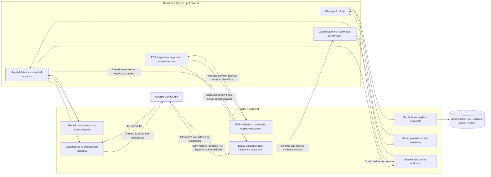
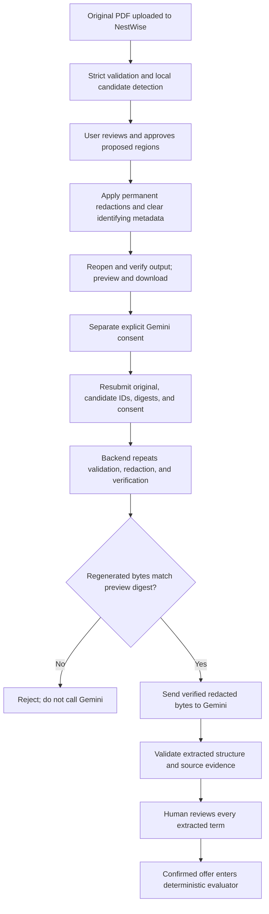

# NestWise
https://nestwise-7fth.onrender.com

> **Understand the true cost of renting before you sign.**

NestWise is a solo hackathon project that helps renters explore Chicago housing areas, evaluate a rental offer's known and uncertain costs, and compare what could change under financial stress. Its calculations come from deterministic backend code; optional Gemini features extract or explain information for a renter to review.

**Demo video:** _Final video link to be added._

The complete AI experience is demonstrated locally. This repository's Render configuration keeps public Gemini features disabled.

## The problem

An advertised rent is only one part of a rental commitment. Renters may also need to account for refundable deposits, prepaid rent, application and move-in fees, mandatory monthly charges, and utilities. Some terms are missing or unclear until a lease or fee schedule is reviewed. Comparing offers is difficult when upfront cash, recurring obligations, and total expenses are mixed together.

Those distinctions matter when a renter's assumptions change. A utility increase, lost roommate contribution, or early departure can affect cash flow, while unknown lease obligations remain unknown. NestWise helps make the inputs, calculations, and unresolved questions visible before a renter decides what to ask or confirm.

## The renter journey

1. **Explore Chicago areas.** Adjust budget and access preferences, inspect public housing benchmarks on a map, and compare two ZIP-code areas.
2. **Start a rental analysis.** Use the Guided Rental Advisor, enter terms manually, or try a clearly labeled synthetic example.
3. **Optionally review a lease.** For a supported PDF, inspect proposed private-information redactions, approve them, export and preview the result, and separately consent before sending the regenerated redacted PDF to Gemini.
4. **Review the costs and uncertainty.** Inspect known monthly obligations, move-in cash, lease expense, refundable amounts, and terms that still need confirmation.
5. **Explore tradeoffs.** Run stress scenarios, compare two rental offers, read grounded follow-up questions, and optionally request constrained AI explanations.

The Chicago explorer and rental analysis are separate product areas. Housing benchmarks help explore places; the rental evaluator uses a specific offer's validated terms. Neither flow stores a renter profile or saved offer on the server.

## Features

### Explore Chicago

- Map and shortlist for 64 Chicago-area Census ZIP Code Tabulation Areas (ZCTAs), with five HUD bedroom-size benchmarks.
- Budget sensitivity scenarios and a two-area comparison using backend-returned values.
- Optional CTA rail station points, nearest-station facts, and straight-line distance to the demo Loop destination.
- ZIP selection and responsive Map/Results navigation.

HUD values are program benchmarks, not rental listings. Census ZCTAs approximate postal ZIP areas. Distances are straight-line measurements from representative points, not routes or travel times.

### Analyze a rental

- Adaptive Guided Rental Advisor, manual entry, and synthetic example data.
- A deterministic evaluator for known recurring housing costs, upfront cash, nonrefundable expenses, prepaid rent, refundable cash held, monthly cash flow, and optional profile-based affordability and savings projections.
- Explicit distinctions between a known subtotal and a complete total, between unknown and confirmed-none terms, and between household contractual costs and expected roommate contributions.
- An optional Gemini Rental Decision Brief, server-generated follow-up questions, utility/roommate/early-departure stress scenarios, lease-clause explanation, and rental comparison interpretation.
- Gemini can select from server-owned explanation statements; the server validates selections and renders the displayed text. It does not provide the financial calculations.

### Privacy-first PDF workflow

- Strictly validate supported PDFs and detect a narrow set of sensitive text regions locally.
- Require a renter to approve each proposed redaction. PyMuPDF applies actual text redactions, then the backend reopens and verifies the output before download.
- Preview the verified PDF and require a separate, initially unchecked consent before AI analysis.
- On final submission, the backend reprocesses the original, rechecks the approved region IDs, regenerates and verifies the PDF, and compares its digest to the previewed output. Only the regenerated bytes are sent to Gemini.
- Feed extracted findings into the existing evidence review and explicit confirmation workflow before those terms can reach rental evaluation.

Automated detection is narrow: it can miss personal information. Redaction is not guaranteed anonymization; the renter must review the entire exported file.

### Screenshots to add

No screenshot files are currently included in the repository. For the final submission, capture the Chicago map with its shortlist, a synthetic rental result that shows known subtotals and unresolved terms, and the redacted-PDF preview followed by the human-review screen. Use synthetic data only; do not include personal lease or profile information.

## Architecture



The frontend is a React 18 and TypeScript application built with Vite. It calls same-origin `/api` routes; in local development Vite proxies them to FastAPI. FastAPI serves the prebuilt public housing data and runs the optimizer, rental calculations, stress tests, comparisons, and PDF workflow. Gemini calls are server-side and optional. There is no application database, cloud document store, account system, or persistent renter profile in this implementation.

## Privacy-first PDF pipeline

The PDF path separates redaction approval from AI consent:



The original PDF reaches the NestWise backend for inspection and regeneration. The approved workflow does not forward the original PDF to Gemini. A SHA-256 digest identifies the bytes the renter previewed; by itself it proves neither that content was redacted nor that the browser is trustworthy. At final submission, the backend checks the original digest, recomputes the candidate catalog from the original bytes, validates the selected IDs, applies redaction again, verifies the new PDF, and compares that regenerated output's digest with the preview digest. Gemini receives only the server-regenerated output if the digests match and consent is valid.

Supported PDFs are unencrypted, selectable-text documents with 1–80 pages and at most 10 MiB. The workflow rejects malformed/repaired and image-only files and documents with images, vector drawings, links, forms, annotations, embedded/associated files, or detected active content. OCR and handwritten, scanned, or graphical-signature detection are not supported. Candidate detection is limited to explicit patterns such as email, labeled phone/identity/account information, labeled names, and typed signatures. A candidate may be missed or mapped imperfectly; review every page before sharing. Even a verified output can retain undetected or unselected information.

Files and approval state are held in request or browser memory, not application storage. Starlette may transiently spool multipart uploads; operating-system memory/swap and provider handling are outside the application's control. Inspect and export do not call Gemini. The final analysis requires separate consent. Pasted-text extraction is a separate route and sends the submitted text to Gemini when enabled.

## Responsible AI and data handling

| Step | What it does | What it does not establish |
|---|---|---|
| Deterministic evaluation | Recomputes costs from validated rental terms, with cents-based calculations. | It does not discover missing lease terms or guarantee a renter can afford an offer. |
| Gemini extraction | Produces candidate terms from submitted text or the approved redacted PDF. | A model candidate is not a confirmed fact. |
| Evidence verification | Checks extracted excerpts against locally parsed source text. PDF page references are separately verified. | A matching excerpt does not establish legal meaning or enforceability. |
| Human review | Requires a decision for every draft term before confirmation. | It is not legal advice or a guarantee that extraction is complete. |
| Grounded explanations | Uses minimized evaluator facts and allowed server-owned statement IDs; server templates render the final text. | It does not forecast outcomes, calculate money, or choose a universally best rental. |

Lease content is treated as untrusted input, not instructions; extraction prompts explicitly treat document text and test-only instructions as data. Schemas, evidence, and monetary terms are checked on the backend. For the decision brief, follow-up prioritization, stress interpretations, and comparison guidance, Gemini selects allowed server-owned IDs and the server renders the final statements. The clause helper is different: it returns a bounded structured paraphrase, which is checked for an exact source excerpt and unsupported numeric claims before display. AI clause explanations are informational, not legal determinations.

Gemini is optional and called only through explicit user actions. The backend keeps the API key out of the browser, applies a shared process-local limit of five AI submissions per minute per client address, and maps provider failures to sanitized responses. The limiter is not distributed abuse protection or a hard spending cap. Provider availability, retention, and terms depend on the configured Google service and account. Review applicable provider terms before sending any lease content. Use synthetic or appropriately redacted documents for demonstrations.

No database or persistent profile store is used. The browser keeps offers, profiles, documents, and outputs in page/component memory; refreshing or leaving the PDF workflow clears them. This is not a claim of complete security, anonymization, or independent compliance certification.

## Financial model

The evaluator recomputes results from a validated `RentalOffer` and optional `FinancialProfile`. It preserves distinctions that a single rent total would hide:

| Term | How NestWise treats it |
|---|---|
| Advertised base rent | Contract benchmark before modeled concessions; the household amount remains gross. |
| Identified monthly obligation | Rent plus known required recurring fees and any stated utility estimate. Completeness flags determine whether the number is a subtotal. |
| Upfront cash | Known amounts due at move-in, including prepaid rent and refundable amounts. It is not the same as nonrefundable expense. |
| Refundable deposit | Cash held separately from lease expense; return is never promised. |
| Prepaid rent | Assigned to a lease month so the same rent is not counted again as a monthly cash payment or extra expense. |
| Roommate contribution | An assumption about the renter's modeled share. Contractual household liability remains gross. |
| Unknown terms | Remain unknown; the system does not treat them as zero or confirmed absent. |
| Estimated utilities | Included only as an estimate and labeled accordingly. |

The stress engine supports a specified utility increase, loss of a modeled roommate contribution, and early departure with explicitly supplied assumptions. Results describe hypothetical scenarios, not predictions or legal conclusions. Early-departure obligations can remain unknown.

The synthetic Batch 11B example uses $1,600 monthly rent, $40 mandatory internet, and $130 estimated utilities. The known monthly housing subtotal is $1,770; incomplete terms remain unresolved rather than silently becoming zero. This is generated sample data, not a market observation.

## Housing data

The public explorer uses these datasets:

| Dataset | Source and geography | Role and limits |
|---|---|---|
| HUD FY2027 Small Area Fair Market Rents (SAFMR) | U.S. Department of Housing and Urban Development; ZIP-level benchmarks filtered to the Chicago HUD metro area and 606xx/607xx/608xx core. | Studio through four-bedroom program payment-standard benchmarks, not live listings or predicted asking rents. [HUD data](https://www.huduser.gov/portal/datasets/fmr/smallarea/index.html) |
| 2020 Census cartographic ZCTA boundaries, 1:500,000 | U.S. Census Bureau; statistical ZCTAs joined by five-digit identifier. | Map geometry and representative points; ZCTAs approximate postal ZIP geographies and are generalized for display, not address-level boundaries. [Census ZCTA data](https://www2.census.gov/geo/tiger/GENZ2020/shp/) · [What ZCTAs are](https://www.census.gov/programs-surveys/geography/guidance/geo-areas/zctas.html) |
| Chicago Transit Authority GTFS | CTA transit feed; rail-served parent stations identified from rail trips and stop times. | 143 station points, nearest-station and within-2-km measures, and the Clark/Lake Loop demo point. Feed publication date is unavailable in the supplied archive; distances do not represent service or travel time. [CTA GTFS](https://www.transitchicago.com/developers/gtfs/) |

The app's public files contain the HUD/Census/CTA core and no Zillow-derived fields. The build pipeline can optionally create a local Zillow ZORI-enriched output, but it is Git-ignored and is not used by the public frontend. Redistribution permission for ZIP-derived ZORI values has not been established; do not publish those local enriched files. [Zillow Research data](https://www.zillow.com/research/data/).

The explorer uses 64 matched ZCTAs and 143 rail stations from the supplied data snapshot. ZCTA representative points are area-level approximations. The Loop destination is a demo assumption, not a renter-selected workplace. Neither straight-line measure equals walking, driving, or transit travel time. The CTA archive does not provide an authoritative feed publication date.

## Technology

| Layer | Implemented stack |
|---|---|
| Web client | React 18, TypeScript, Vite 6, Tailwind CSS 3, React Leaflet 4, Leaflet 1.9, Lucide |
| API and calculations | Python 3.12, FastAPI, Pydantic, Shapely; deterministic housing optimization, rental evaluation, comparison, and stress modules |
| AI and document processing | `google-genai` SDK, PyMuPDF, pypdf, `python-multipart`; Gemini calls are backend-only |
| Housing-data build | pandas, GeoPandas, openpyxl, and project scripts; production serves only committed public core data |
| Local/deployment runtime | Vite development server plus FastAPI; single-service Docker image prepared for Render |

## Run locally on Windows

The full AI workflow is intended for a local demonstration. Manual rental analysis, public housing exploration, deterministic comparisons, and stress scenarios do not require a Gemini key. Text extraction, AI explanations, and approved redacted-PDF analysis require a working server-side key, provider access, and local feature enablement.

### 1. Create a Python environment

From the repository root in PowerShell:

```powershell
py -3.12 -m venv .venv
.\.venv\Scripts\python.exe -m pip install --upgrade pip
.\.venv\Scripts\python.exe -m pip install -r backend/requirements-dev.txt
```

If `.venv` already exists, activate or invoke its Python executable as shown. `requirements-dev.txt` includes backend runtime and test/data-development dependencies; the Docker image installs only `backend/requirements.txt`.

### 2. Configure local Gemini (optional)

If you do not already have a root `.env`, copy the placeholder file. Then edit it in an editor:

```powershell
if (-not (Test-Path .env)) { Copy-Item .env.example .env }
notepad .env
```

Set `GEMINI_API_KEY` to your own key. `GEMINI_MODEL` defaults to `gemini-3.5-flash-lite`. Do not paste credentials into source, frontend variables, screenshots, or issue reports. Local development enables Gemini when configured unless `NESTWISE_ENABLE_PUBLIC_GEMINI=false` is explicitly set. Production mode does not load the repository `.env` and the supplied Render configuration sets the public Gemini flag to `false`.

### 3. Start the backend

In a PowerShell terminal at the repository root:

```powershell
.\.venv\Scripts\python.exe -m uvicorn backend.app.main:app --host 127.0.0.1 --port 8001 --reload
```

Optional safe readiness check: open `http://127.0.0.1:8001/api/lease/status`. It reports configuration/readiness and model name, never the key. Readiness does not prove provider connectivity or quota.

### 4. Start the frontend

In a second PowerShell terminal:

```powershell
Set-Location frontend
npm ci
npm run dev
```

Open `http://127.0.0.1:5173/`. Vite proxies `/api` to `127.0.0.1:8001` by default. If FastAPI uses another port, set the loopback-only override before `npm run dev`, for example:

```powershell
$env:NESTWISE_API_PROXY_TARGET = 'http://127.0.0.1:8000'
npm run dev
```

### 5. Run checks

From `frontend/`:

```powershell
npm run typecheck
npm test -- --reporter=dot
npm run build
```

From the repository root:

```powershell
.\.venv\Scripts\python.exe -m pytest -q
```

## Verification status

The current checkout was verified on 2026-10-25: **281 backend tests passed**, **114 frontend tests passed**, TypeScript typecheck passed, the production build passed, and `git diff --check` passed. Vite reported the existing advisory for a 529.12 kB minified JavaScript chunk. These are automated checks; provider behavior in automated tests is mocked. The [Batch 11B report](docs/BATCH_11B_REDACTED_PDF_ANALYSIS.md) records exactly one live synthetic Gemini inference through the PDF analysis API; subsequent review decisions were scripted from known fixture facts, not completed in a human browser session. No live Gemini request was repeated for this README task.

No fresh manual browser pass at desktop/mobile widths is claimed here. The latest report also records that PyMuPDF licensing remains unresolved for deployment.

## Limitations

- **PDF support:** only bounded, selectable-text PDFs without the rejected content types described above. There is no OCR, and unsupported structure fails closed.
- **Detection:** patterns are narrow and may miss sensitive text. Redaction does not guarantee anonymization; users must inspect the complete result.
- **AI:** extraction can be incomplete or incorrect. Gemini availability, quota, retention, and terms depend on the configured provider account. The process-local limiter is neither distributed protection nor a hard spend limit.
- **Financial terms:** incomplete inputs produce known subtotals, not complete estimates. NestWise does not infer a missing term as zero, determine legal obligations, or guarantee affordability.
- **Housing data:** benchmark rents are not available listings; ZCTAs and representative points are approximate; straight-line distance is not commute time. No user-specific workplace routing is implemented.
- **Persistence:** profiles and offers are held in page memory and clear on refresh/navigation. There is no account or saved server-side renter data.
- **PyMuPDF licensing:** PyMuPDF is offered under AGPLv3 or commercial terms. The project's licensing decision is unresolved; PDF feature deployment remains blocked pending owner review. See [PyMuPDF licensing](https://pymupdf.io/licensing).
- **Public deployment:** `render.yaml` sets `NESTWISE_ENABLE_PUBLIC_GEMINI=false`. Do not treat the full AI/PDF workflow as publicly available or enable unauthenticated public inference based on local tests.

## Hackathon

NestWise is a solo submission for the **GDG Build with AI × Hacktoberfest 2026 AI for Housing competition**. No award, judging result, partnership, user study, or measured housing impact is claimed.

**Final demo video:** _Link to be added when available._ The planned recording demonstrates the complete AI experience locally; no public AI deployment URL is provided here.

## Future improvements

- Broaden supported PDF handling and sensitive-information detection while retaining explicit review and output verification.
- Add stronger shared abuse controls before considering any public Gemini access.
- Complete accessibility verification across screen sizes and assistive technologies, and test the flows with renters.

## Project notes

- [Batch 9: Guided Rental Advisor](docs/BATCH_9_GUIDED_ADVISOR.md)
- [Batch 10A: AI Decision Brief](docs/BATCH_10A_AI_DECISION_BRIEF.md)
- [Batch 10B: Follow-up questions](docs/BATCH_10B_FOLLOWUP_QUESTIONS.md)
- [Batch 10C: Stress explanations](docs/BATCH_10C_STRESS_EXPLANATIONS.md)
- [Batch 10D: Lease-clause explainer](docs/BATCH_10D_CLAUSE_EXPLAINER.md)
- [Batch 10E: Comparison advisor](docs/BATCH_10E_COMPARISON_ADVISOR.md)
- [Batch 11A: PDF redaction](docs/BATCH_11A_PDF_REDACTION.md)
- [Batch 11B: Approved redacted-PDF analysis](docs/BATCH_11B_REDACTED_PDF_ANALYSIS.md)
