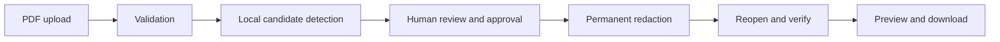

# Batch 11A: privacy-first PDF redaction

## Workflow

Analyze keeps the Guided Rental Advisor as its primary action. A secondary entry opens a separate, three-step PDF redaction tool:



The user chooses a PDF, reviews proposed regions, explicitly checks each region to approve it, and requests export. The original and output bytes remain in browser/backend memory for this interaction. Browser state does not write either document to local or session storage. FastAPI/Starlette may spool multipart uploads to transient temporary storage before the route reads them; application code does not create persistent uploaded-file records. The API uses `no-store` response headers.

The redaction endpoints are `POST /api/pdf-redaction/inspect` and `POST /api/pdf-redaction/export`. Both are separate from Gemini routes and do not import or call the Gemini provider. Inspection accepts one `application/pdf` `.pdf` upload up to the existing 10 MiB and 80-page limits. Export accepts the same original file, the inspection SHA-256 digest, and repeated `candidate_ids` form fields. The backend checks the digest, reparses the exact bytes, recomputes candidates, and accepts only IDs from that recomputed catalog. It does not accept client coordinates. Empty selection, duplicate/unknown IDs, changed bytes, invalid bounds, and failed verification are rejected. Responses, including errors, are marked no-store; the PDF download uses a fixed attachment filename and `nosniff`.

## Supported and rejected PDFs

Supported input is a valid, unencrypted, selectable-text PDF with 1–80 pages, ordinary embedded fonts, and extractable text. Standard page rotation is represented in candidate display coordinates; redaction uses the underlying unrotated PDF coordinates. The preview shows only pages containing candidates.

The implementation rejects malformed or non-PDF input, password-protected PDFs, image-only/scanned pages, and documents containing images, vector drawings, links, annotations, widgets/forms, embedded files, or detected active catalog actions. It does not use OCR, alter arbitrary PDF objects, or add manual redaction regions. A clear identity label whose value is on another line, handwritten, or otherwise unmappable fails closed. Unsupported content is rejected rather than claimed to be sanitized.

## Detection and review

Detection is deterministic and based on PyMuPDF word geometry grouped by page and line. It proposes candidates for email addresses; labeled phone numbers; labeled Social Security, driver-license, or passport identifiers; labeled account, routing, card, and payment numbers; names following explicit Tenant, Applicant, Guarantor, or Landlord labels; and typed names following an explicit signature label. The detector does not use AI or general capitalized-name detection. It does not select ordinary rent, deposit, application-fee, utility, duration, or penalty amounts absent a sensitive identifier label.

The API returns a candidate ID, 1-based page, display-coordinate bounding box, category, neutral label, and `review_required`; it never returns the matched private value. The UI has an accessible checkbox for every candidate and overlays proposed/approved boxes on a rendered page preview. All candidates begin unapproved. Keyboard-operated native checkboxes provide the same selection path as pointer use. Each client address has a five-request-per-minute process-local limit shared by inspect and export. No manual region editing is provided.

## Redaction and verification

For approved IDs, the backend adds PyMuPDF redaction annotations to freshly recomputed text word boxes and calls the library's actual `Page.apply_redactions()` operation. It saves a new byte stream with full garbage collection and compression, not incremental saving. It clears standard identifying document metadata and XMP metadata while retaining a PyMuPDF producer notice for the library's license terms. It does not merely draw a black overlay over recoverable text.

Before returning a file, the backend reopens the new bytes and checks page count and parser validity, confirms approved text is absent from extracted page text and metadata, confirms unselected detected candidates remain extractable, checks that original visible currency expressions remain, and checks that each approved region renders black. A failed check returns an error and no PDF bytes. These checks cover supported text, metadata, and rendered page representations; they do not prove that every conceivable PDF encoding or steganographic representation is clean. The user is told to review the exported document and that automatic detection can miss private information. The interface never says “fully anonymized.”

## Privacy and threat limits

No Gemini or third-party AI provider receives the original or redacted PDF through these endpoints. No database, cloud bucket, persistent upload record, or file path is used. Request bodies and PDF contents are not logged by application code; exceptions are converted to fixed messages. The user sees no extracted private values in the candidate list. Multipart framework spooling, process memory, operating-system swap, browser memory, and deployment logs remain outside an absolute in-memory privacy guarantee. PDF parsing has CPU/memory denial-of-service risks despite file/page limits and worker-pool execution. Run the service with ordinary resource limits and keep its PDF dependencies patched.

Automatic patterns are intentionally narrow. They can miss unlabeled names, handwritten signatures, image text, unusual identifiers, text represented as paths, and identifier layouts not supported by the line-based mapping. Current policy rejects many image/vector-heavy PDFs rather than attempting incomplete cleanup. Manual review of the exported PDF remains necessary.

## Dependency and licensing

`PyMuPDF>=1.24,<2` was added because the existing `pypdf` dependency does not supply the geometric permanent-redaction operation used here. PyMuPDF is offered under AGPLv3 or a commercial license. Its publisher describes network use of the AGPL build as carrying source-availability obligations; proprietary/SaaS deployments may need a commercial license. This repository does not state a license or establish that AGPL obligations fit the intended product. **Before deploying or distributing this feature, the owner must confirm AGPL compliance or obtain the appropriate commercial license.** See [PyMuPDF licensing](https://pymupdf.io/licensing) and [redaction API documentation](https://pymupdf.readthedocs.io/en/latest/page.html).

## Tests and manual verification

Synthetic backend coverage is in `tests/test_pdf_redaction.py`: candidate categories and geometry, rent/deposit/fee preservation, selected text removal, metadata clearing, rotated pages, signature/malformed/encrypted/oversized/image-only/annotated input, invalid IDs, empty selection, changed-document digest, no-store download, no Gemini invocation, and verification-failure blocking. Frontend coverage is in `frontend/src/test/pdfRedaction.test.tsx` for upload, accessible selection, export, preview/download, errors, and resetting a changed document.

The typed-signature follow-up found a deduplication defect, rather than an unsupported PDF or label format. PyMuPDF 1.28.2 extracts the fixture line as `Typed`, `Signature`, `of`, `Tenant:`, `Jordan`, `Sample`. Both the signature pattern and the identity-name pattern match `Jordan Sample` at the same bounding box. Alphabetical category ordering previously kept `identity_name` and discarded `signature` when collapsing the duplicate region. The detector now gives an explicit signature match priority for the same region and value. Label recognition, word mapping, and financial exclusions remain unchanged; this does not add handwritten, scanned, or graphical signature support.

Follow-up tests cover three supported typed-signature labels, exact name geometry without a duplicate candidate, an unrelated name and ordinary financial amounts producing no candidates, and a signature-only export whose actual reopened PDF bytes no longer expose either name token while rent, deposit, and unrelated text remain extractable.

The subsequent rejection investigation reproduced inspection of the exact synthetic `NestWise_PDF_Redaction_Test_Lease.pdf` from the owner's Downloads directory. Both pypdf and PyMuPDF found two selectable-text pages, one embedded attachment, and one associated-file (`AF`) entry. Page images, drawings, links, Form XObjects, annotations, and widgets were absent. The original rejection condition was `document.embfile_count()` in the combined `interactive_content` check; the attachment is a document-level structure that page-only inspection misses. The pypdf non-zero-indexed-xref warning did not abort parsing, and PyMuPDF reported `is_repaired=False`. Fonts, metadata, and ordinary page resources were not the cause. No restriction was relaxed: the file remains correctly rejected until the owner exports a new PDF without embedded attachments or associated files.

Intake now distinguishes `embedded_attachments` and `associated_files` from other unsupported structures and returns a fixed, clearer attachment rejection message. Optional diagnostics use `NESTWISE_PDF_DIAGNOSTICS=1` and record only allowlisted rejection categories and structural booleans/counts. They exclude filenames, attachment names and bytes, PDF text, metadata values, credentials, and raw exception messages. For local diagnosis, set the flag before starting the existing backend command:

```powershell
$env:NESTWISE_PDF_DIAGNOSTICS = '1'
.\.venv\Scripts\python.exe -m uvicorn backend.app.main:app --host 127.0.0.1 --port 8001 --reload
```

The exact file's local API response remained HTTP 422 with `category=embedded_attachments`, `embedded_files=1`, `forms=false`, and `page_count=2`; its no-store header remained intact. ReportLab 4.5.1 was installed for regression testing and declared only in `backend/requirements-dev.txt`. Clean two-page ReportLab and PyMuPDF PDFs pass inspection and actual redaction/export verification; otherwise text-only variants with an embedded associated file are rejected. Tests also assert that the diagnostic output contains no synthetic private markers and remains disabled unless explicitly enabled.

Backend verification was initially blocked in the sandbox. It was subsequently executed outside the sandbox using the owner's installed Python 3.12.1 and PyMuPDF 1.28.2. Frontend results below are retained from the original Batch 11A implementation; this focused backend correction did not change frontend code.

Automated verification:

| Check | Result |
|---|---|
| Focused PDF redaction pytest | **24 passed**, one existing Starlette/TestClient deprecation warning |
| Backend full pytest | **256 passed**, the same existing deprecation warning |
| Frontend typecheck | Passed |
| Frontend tests | **103 passed** across 10 files |
| Frontend production build | Passed; Vite 6.4.5, with the existing large-chunk advisory |
| `git diff --check` | Passed; Git printed line-ending conversion notices |
| Actual exported PDF bytes | Verified in synthetic backend tests, including typed-signature removal, financial preservation, metadata clearing, and rotated-page export; this does not establish correctness for every PDF representation |

After installing the declared backend requirements, run from the repository root:

```powershell
python -m pytest -q tests/test_pdf_redaction.py
python -m pytest -q
```

From `frontend/`:

```powershell
npm run typecheck
npm test -- --reporter=dot
npm run build
```

Then, using a synthetic PDF only, inspect a document, approve one email region, export it, confirm that the response is a downloadable PDF, reopen it in a PDF reader, search for the selected address, and confirm rent/deposit figures remain. Also verify a scanned PDF, altered upload, and empty selection are rejected. Do not upload personal leases during QA.

## Batch 11B boundary

Batch 11A's inspection and export endpoints still end at verified preview/download and do not call Gemini. The subsequent [Batch 11B implementation](BATCH_11B_REDACTED_PDF_ANALYSIS.md) adds a separate explicit-consent action and server-enforced regeneration/digest check before AI submission. It also allows a no-candidate export only after independent-review acknowledgment. The original Batch 11A results above remain historical verification; see the Batch 11B report for the current API schemas and results.
