# Batch 11B: approved redacted PDF analysis

## Existing flow inspected before implementation

Before this batch, Batch 11A used `PdfRedactionWorkspace`, `/api/pdf-redaction/inspect`, and `/api/pdf-redaction/export`. The browser kept the original `File`, selections, preview, and output blob in component memory. Export recomputed candidates and validated redacted output but rejected all empty selections. The PDF full rewrite regenerated a trailer ID, so repeated exports first needed to become byte-stable before final approval could bind a digest reliably.

Separately, `/api/lease/extract-pdf` forwarded original bytes to `extract_with_gemini()` after pypdf validation. `/api/lease/extract-text` handled pasted text. Both reused the existing production feature gate and shared process-local Gemini limiter. The provider returned `LeaseExtraction`; evidence verification and `make_draft()` produced a `LeaseDraft`. `RentalWorkspace` opened `LeaseReview`, called `/api/lease/confirm`, then `/api/rental/evaluate` with only the confirmed offer. The four-stage Guided Advisor and financial calculations were independent and remain reusable as fallback. Moving extracted offers into the narrower guided model could drop terms and provenance, so this batch reuses the existing confirmed-extraction evaluation path.

## Implemented trust boundary

Final consent uses stateless server recomputation: the final request supplies the original bytes, original digest, approved candidate IDs, previewed-output digest, explicit Gemini consent, and a separate acknowledgment when no candidates were detected. The server rebuilds and verifies the output, compares exact bytes by digest, and submits only that newly generated output to the existing provider. No browser claim or digest alone proves redaction. Direct raw-PDF extraction is retired from the public API. No server-side PDF store, signed approval token, new provider, or new financial calculation was added.

```mermaid
flowchart LR
    A[Original PDF] --> B[Strict inspection and candidate catalog]
    B --> C[User approves regions]
    C --> D[Permanent redaction and output verification]
    D --> E[Preview and download exact output]
    E --> F[Separate unchecked Gemini consent]
    F --> G[Re-upload original and approval record]
    G --> H[Recompute redactions and verify output]
    H --> I{Matches preview digest?}
    I -->|No| J[409; no provider call]
    I -->|Yes| K[One Gemini request with verified output only]
    K --> L[Evidence from verified PDF; review draft]
    L --> M[Explicit review and confirmation]
    M --> N[Existing deterministic evaluation]
```



## API contracts and byte identity

`POST /api/pdf-redaction/inspect` remains the Batch 11A multipart upload endpoint. It returns the original SHA-256 digest, page information, and recomputable candidate IDs. The Batch 11A strict intake rules, 10 MiB/80-page caps, and unsupported-content checks remain in force.

`POST /api/pdf-redaction/export` accepts these multipart fields:

| Field | Contract |
|---|---|
| `file` | Original inspected PDF |
| `document_digest` | 64 lowercase hexadecimal characters |
| `candidate_ids` | Repeated approved IDs; empty only if the recomputed catalog is empty and acknowledgment is explicit |
| `acknowledge_no_candidates` | Literal form string `true` or `false`; default `false` |

Successful export returns only the verified PDF as an attachment with `X-Redacted-PDF-SHA256`, `no-store`, and `nosniff` headers. The browser retains the output blob and digest from that same response. Export never calls Gemini.

`POST /api/lease/extract-redacted-pdf` accepts **exactly one** multipart `file` and one `approval` JSON-string field. Duplicate or extra multipart fields are rejected. The approval JSON is a strict Pydantic model with unknown properties forbidden:

```json
{
  "document_digest": "<SHA-256 of original inspected bytes>",
  "approved_pdf_digest": "<SHA-256 from the verified preview response>",
  "candidate_ids": ["region-0001"],
  "consent_to_gemini": true,
  "acknowledge_no_candidates": false
}
```

Both digests must be 64 lowercase hex characters. IDs must match `region-` followed by 4–8 digits, have no duplicates, and number at most 2,000. Consent is a required strict boolean and must be `true`; numeric or string substitutes fail. The no-candidate acknowledgment is a strict boolean defaulting to `false`. It is accepted only when the server's recomputed catalog is empty. A client `redacted=true`, extra coordinates, an additional replacement PDF, an arbitrary approved digest, or a changed original cannot bypass redaction.

The endpoint enforces the existing Gemini production gate and shared five-per-minute per-client process limiter. It reads the original with the existing upload bound, reruns strict intake, recomputes candidates, checks the original digest and selected IDs, applies permanent redaction, sanitizes metadata, and runs Batch 11A output verification. It then hashes the newly produced output. A mismatch with the previewed digest returns 409 before any provider call. Only matching, newly verified output is passed to the existing Gemini provider. The final endpoint does not accept a browser-supplied redacted PDF body.

Repeated output must be byte-stable for option C to work. Approved IDs are canonicalized before redaction. The full rewrite removes the old trailer ID and suppresses creation of a new random ID using `no_new_id=True`; identifying metadata is cleared and the PyMuPDF producer notice remains. Tests compare preview bytes with the exact bytes observed at the mocked provider, including reversed request ID order. A change in PDF library behavior or selected inputs that changes bytes fails closed with 409 and requires a new preview.

`POST /api/lease/extract-pdf` now returns fixed HTTP 410 and is hidden from the API schema. It cannot forward any PDF to Gemini. Its diagnostic script and former route tests were migrated to the approved workflow. Pasted-text extraction retains its existing separate behavior and privacy disclosure.

## Preview, consent, review, and evaluation

The Guided Rental Advisor remains the primary Analyze action. The secondary PDF entry now provides a continuous path from inspection to export, optional AI extraction, existing `LeaseReview`, `/api/lease/confirm`, and `/api/rental/evaluate`.

All candidate checkboxes and the final Gemini consent begin unchecked. Export requires at least one approved region if candidates exist. When none are detected, the renter must independently review and explicitly acknowledge that absence of detections is not proof of privacy. That path still rewrites metadata and verifies the output, but accurately says that zero regions were removed.

After export, the UI shows **Review your redacted PDF**, the verified preview, applied count, download, and a separate consent checkbox. The **Analyze approved PDF with AI** action is available only when backend status reports AI ready and a verified export exists; consent must then be checked to enable it. AI unavailability does not prevent inspection, export, download, or guided fallback. Export, checkbox changes, and rendering never automatically invoke AI.

Changing the file, returning to region selection, or changing the selected regions invalidates the old output and final consent. Operation tokens and abort signals prevent stale responses from opening a review screen after approval changes. An abort prevents stale browser display; it does not guarantee that an already-started server/provider request is canceled. Failed extraction leaves the verified preview and download in memory and offers an explicit retry or guided fallback. There are no automatic retries.

After extraction, the existing human-review screen opens with source excerpts verified only against text parsed from the **verified output**. Every draft term still needs a decision before confirmation; findings do not go directly into a financial offer or evaluator. Unknown holding deposits and charge-list completeness remain unknown. Ambiguous early-departure obligations remain unresolved. Reviewed offers preserve full extracted fields/provenance rather than being flattened into the narrower guided form. Seamless guided prefill is deferred to avoid dropping terms or weakening semantics.

Integration tests found a pre-existing adapter issue: `mark_unknown` for first/last-month rent timing supplied `None` to the strict rental model. The confirmation adapter now maps only unresolved `None` timing to the existing `unknown` state. It still rejects malformed boolean, numeric, or arbitrary-string timing values. Financial formulas were not changed. Confirmation Pydantic errors now use a fixed message so rejected document-derived values are not echoed.

## Privacy, supported files, and failure behavior

The original PDF reaches NestWise during inspect, export, and final recomputation. This workflow sends only the internally regenerated, verified output to Google after explicit consent. Unselected text and undetected private information can remain in that output and will reach the provider. Automatic detection is narrow and is not anonymization; the user must review the entire output. This workflow is not a promise of end-to-end encryption or provider-side non-retention. Review Google's applicable terms before using real documents.

The supported format remains unencrypted, selectable-text PDFs without images, vector artwork, links, Form XObjects, annotations, widgets/forms, embedded/associated files, or detected active content. No OCR or manual regions were added. A PDF that contains an embedded source attachment remains rejected even when its visible pages are text-only.

Originals, verified output, and approval data are request/component memory only. No database, document cache, approval-token registry, file path, or cloud bucket is introduced. Starlette may transiently spool multipart uploads before route processing. The browser releases object URLs when output changes or the PDF component unmounts; leaving Analyze or starting another method clears that document session. Ordinary process memory, swap, framework temporary storage, resource exhaustion, and parser vulnerabilities remain limitations. PDF parser/render work and the synchronous provider call run in the worker pool.

Document responses and errors have no-store headers. New approval-validation and provider errors use fixed sanitized messages. Application diagnostics log only existing structural flags, field IDs, stage/category, and timings; original/output bytes, source text, raw model responses, keys, and financial profiles are not logged by this feature. SHA-256 identifies bytes; it is not authentication. The existing process-local limits are neither distributed abuse prevention nor a hard spend cap.

| Failure | Behavior |
|---|---|
| Invalid/unsupported PDF or redaction verification failure | 413/415/422; no provider call |
| Original or approved-output digest mismatch | 409; regenerate and review output |
| Invalid/duplicate IDs, absent/false consent, invalid no-candidate acknowledgment | 422; no provider call |
| Production AI disabled/missing provider configuration | 503; output download remains usable |
| Local/shared Gemini rate limit or provider quota | 429; no automatic retry |
| Invalid JSON/structured output or provider failure | Sanitized 502; download retained |
| Provider timeout | Sanitized 504; explicit retry only |

## Verification and live evidence

Executed locally with Python 3.12.1, PyMuPDF 1.28.2, and the existing SDK/model configuration:

| Check | Actual result |
|---|---|
| Full backend `pytest -q` | **281 passed**, one existing Starlette/TestClient deprecation warning |
| Frontend typecheck | Passed |
| Frontend tests | **114 passed** across 11 files |
| Frontend production build | Passed; Vite 6.4.5, 529.12 kB minified main chunk advisory |
| `git diff --check` | Passed; Git emitted line-ending conversion notices only |
| Controlled live synthetic API test | Exactly **one** Gemini inference; inspect/export/extraction/confirmation/evaluation returned 200 |

Backend tests cover replacement-file/claim bypass attempts, changed originals and preview digests, missing/false/string consent, invalid and duplicate IDs, no selected candidates, no-candidate acknowledgment, unsupported structures, verification failure, production gating before provider work, shared rate limits, no-store responses, sanitized JSON/provider/quota/timeout failures, and exact provider-byte identity. They inspect actual generated PDFs to confirm approved fictional identifiers are gone and the rent/deposit figures remain. A mocked complete API path requires explicit review decisions and then uses the real financial evaluator. A temporary-directory check confirms the application creates no document files in that workflow. The existing response-schema, validation, housing, rental, and AI regression tests remain in the full suite.

Frontend tests cover initial unchecked consent, disabled AI action, explicit one-request submission, successful preview/download, unavailable AI with guided fallback, error-preserved downloads, file/selection invalidation, stale request suppression, no-candidate acknowledgment, export failure blocking, and handoff through existing human review before evaluation. Actual live browser desktop/mobile interaction was not performed in this batch.

The single live test used only the generated fictional lease in `scripts/diagnose_redacted_pdf_analysis.py`, containing $1,600 rent, a 12-month term, $800 refundable deposit, $100 application fee, $40 monthly internet, $130 estimated utilities, unknown holding deposit/other charges, and ambiguous early termination. Before inference, the reopened output no longer contained the four selected fictional identity values, and financial terms remained extractable. The actual extraction endpoint returned a valid review-required PDF draft with **7 page-verified terms**; rent and duration matched. The smoke test then submitted **scripted review corrections based on known synthetic facts**, confirmed the offer, and evaluated it. The known monthly subtotal matched $1,770, and the projection/unknown categories stayed incomplete.

This is evidence of the real-provider API pipeline with scripted synthetic review, not a claim that a human completed a live browser end-to-end session or that every model candidate was accepted without correction. Raw provider output and the full document were not printed or saved. No second live inference was made.

## Local manual review

1. Install the existing backend requirements in the working venv. Run `.\.venv\Scripts\python.exe -m pytest -q` from the repository root. From `frontend/`, run `npm run typecheck`, `npm test -- --reporter=dot`, and `npm run build`.
2. Start the local backend on 127.0.0.1:8001 and Vite with the existing commands. Keep keys in the ignored root `.env`. Do not change production/Render settings.
3. Create a local synthetic QA file if needed (this explicit manual command writes only the known generated fixture into your temporary directory):

   ```powershell
   .\.venv\Scripts\python.exe -c "import tempfile; from pathlib import Path; from scripts.diagnose_redacted_pdf_analysis import synthetic_lease_pdf; p=Path(tempfile.gettempdir())/'NestWise_11B_Synthetic.pdf'; p.write_bytes(synthetic_lease_pdf()); print(p)"
   ```

4. Open Analyze and the secondary PDF action. Upload the synthetic fixture, inspect it, and approve the fictional identifier regions. Export, preview, and download. Reopen the file, search for the selected identities, and check the financial amounts.
5. Confirm no AI request occurs before final consent. If local `/api/lease/status` reports ready, check the separate consent and choose **Analyze approved PDF with AI** once. This is an additional owner-triggered request and consumes quota; do not repeatedly submit after a failure.
6. Review/correct the findings, open evidence disclosures, and explicitly confirm. Check the existing financial overview, unknown costs, comparison actions, and stress controls. Go back from review to the approved document and verify download remains available.
7. Change selections or the file and confirm prior consent is cleared. With Gemini disabled, verify export/download and guided fallback still work. Check keyboard navigation and desktop/mobile layout manually.

For one deliberate synthetic API smoke in a local environment only, `.\.venv\Scripts\python.exe -m scripts.diagnose_redacted_pdf_analysis --live` performs at most one inference. It uses scripted fixture review and prints only statuses/counts/verification flags. It never loads an owner-supplied lease file. The legacy PDF diagnostic also uses the enforced approval path.

## Files changed for Batch 11B

- New: `backend/app/pdf_redaction/models.py`, `tests/test_redacted_pdf_analysis.py`, `frontend/src/test/batch11b.test.tsx`, `scripts/diagnose_redacted_pdf_analysis.py`, and this report.
- Backend integration: `backend/app/pdf_redaction/{intake,redact}.py`, `backend/app/api/{pdf_redaction_routes,lease_routes}.py`, `backend/app/lease_extraction/workflow.py`, and `backend/app/main.py`.
- Frontend integration: `frontend/src/components/{PdfRedactionWorkspace,RentalWorkspace}.tsx`, `frontend/src/lib/{pdfRedaction,rentalApi}.ts`.
- Existing test/diagnostic migration: `tests/{test_pdf_extraction,test_lease_extraction}.py`, `frontend/src/test/{batch8,pdfRedaction}.test.tsx`, and `scripts/diagnose_pdf_extraction.py`.
- Documentation: `README.md` and the Batch 11A report's follow-up boundary note.

The shared working tree already contained uncommitted earlier-batch edits. This list identifies Batch 11B edits; it does not attribute the existing provider/model/dependency changes to this task. No new dependency was added for Batch 11B.

## Deployment and licensing limitations

`render.yaml`, the model, and the production gate were not changed. Repository production configuration continues to set `NESTWISE_ENABLE_PUBLIC_GEMINI=false`; the new endpoint enforces the same gate. Redaction-only operations remain available independently of Gemini. No public deployment or external account setting was changed, and this feature is not claimed to be publicly operational.

PyMuPDF's AGPLv3/commercial licensing remains unresolved for the intended NestWise distribution. A public GitHub repository alone does not establish compliance with all source-availability, license, notice, and network-use obligations. The code retains the producer notice. Before deploying PDF functionality, the owner must establish that the application/distribution meets the applicable license requirements or obtain a suitable commercial agreement. **Deployment of PDF functionality remains blocked pending licensing review.** This report does not make a definitive legal determination. See [PyMuPDF licensing](https://pymupdf.io/licensing).

Remaining release work includes the licensing decision and a live manual browser pass at desktop/mobile widths. The local real-provider smoke does not justify enabling unauthenticated public Gemini; the existing per-process limiter is insufficient as a distributed protection or monetary cap. No Firebase, Firestore, authentication, new paid infrastructure, cloud storage, financial formulas, or housing datasets were introduced. No commit, push, or deployment was performed, and no later batch was started.
